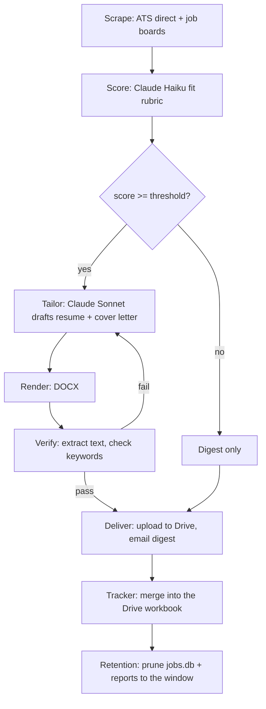

# Houndstooth


*This system is part of the working record behind my [AIDLC series](https://www.linkedin.com/in/dexterdomingo/) on AI-driven development.*

A personal job-application pipeline. It scrapes job postings, scores them for fit
using an LLM, drafts a tailored resume and cover letter for the strong matches,
verifies the generated documents before trusting them, and delivers everything
as an emailed digest with links to the uploaded files.

It has been running daily in production, unattended, since July 2026.

The name: a hound hunts, houndstooth is a suit fabric. It hunts jobs and tailors suits.

## Why this repo has no data

This is the code, not the run. The live pipeline's state, meaning every scraped
job, every score, every generated resume, and the candidate's own resume facts,
is personal and stays in a private repo. What's here is the engineering: the
scraping, the scoring pipeline, the anti-fabrication guardrail, the document
rendering and verification, and the delivery plumbing. `config.example.yaml`
and the `profile/*.example.*` files show the shape of the real inputs with
fictional data, and `sample_output/digest_example.md` shows the shape of a
real output the same way. Nothing in this repo is a real job, a real score,
or a real resume.

<p align="right">(<a href="#houndstooth">back to top</a>)</p>

## Architecture

Four stages, each one a plain Python module, each one runnable on its own.



**Scrape** (`jobhunt/scrape_ats.py`, `jobhunt/scrape_boards.py`). Two sources
run in parallel. Direct ATS endpoints (Greenhouse, Lever, Ashby, Workday) are
queried straight, since a company's own careers API is the freshest, cleanest
copy of its openings and has no anti-bot friction. Job boards (Indeed, Google
Jobs, ZipRecruiter, optionally LinkedIn) are pulled through
[JobSpy](https://github.com/speedyapply/JobSpy) for broader reach. Everything
lands in a SQLite table with a cross-source dedupe hash, and when the same job
shows up from both an ATS and a board, the ATS copy wins (`jobhunt/db.py`).

**Score** (`jobhunt/score.py`). Three cheap stages run before any LLM call:
hard title/salary filters, then a keyword prefilter against the candidate's
own profile. Only what survives both goes to the LLM, which returns a
structured score, a one-line verdict, matched requirements, gaps, dealbreakers,
and resume-targeting tips, all as a single JSON object.

**Tailor** (`phase2_tailor.py`, `jobhunt/tailor/`). For jobs scoring at or
above a threshold, a second LLM call drafts a tailored resume and cover
letter. The candidate facts come from three hand-maintained files merged by
`jobhunt/profile_load.py`: the bullet bank (`resume_template.json`), a
project bank (`projects.json`) and a voice bank (`voice_bank.json`) of
pre-written summaries, anecdotes, openers and closers. `jobhunt/tailor/style.py`
picks the document's shape per posting (audience, section order, titles,
bullet marker), seeded by job id so a re-render is reproducible. This is the
stage with the guardrail, covered below.

**Render + verify** (`jobhunt/tailor/renderers/`, `jobhunt/tailor/verify.py`).
The drafted content becomes an actual `.docx` (or `.pdf`, pluggable). The
renderer never writes free text the model invented, it only lays out fields
from a JSON schema. After rendering, `verify.py` extracts the text back out of
the document and checks it isn't empty, isn't garbled, and actually contains
the keywords the drafter said it would mirror. A failed verification triggers
a revision cycle (max 2 retries) before the job is flagged for manual review
instead of silently shipped.

**Deliver** (`jobhunt/deliver.py`). Verified documents upload to Google Drive,
and an HTML digest with the ranked jobs and live document links gets emailed.
A `digest_log` table remembers which jobs have already been sent, so each
digest leads with what is new since the last one.

**Track** (`jobhunt/tracker.py`). Every digested job is merged into a single
`Houndstooth Job Tracker.xlsx` in the same Drive folder. The merge is
two-way: the Status and Notes columns you edit in the workbook are read back
into `jobs.db` each run, and a job you mark Dismissed or Rejected drops out
of future digests.

**Retain** (`jobhunt/retention.py`). `jobs.db` is committed to git daily in
the private repo, so it has to stay bounded. Rows older than the configured
window are deleted unless acted on (tailored, delivered, or given a tracker
status), deleted ids are tombstoned so a still-live posting is not re-scored
as new, old `reports/` files go with them, and the database is VACUUMed.

`run_all.py` chains scrape and score. `phase2_tailor.py`,
`python -m jobhunt.deliver`, `python -m jobhunt.tracker` and
`python -m jobhunt.retention` run the rest. All of them are wired as
separate steps in `.github/workflows/daily.yml` so a bad step doesn't have
to invalidate the ones before it.

<p align="right">(<a href="#houndstooth">back to top</a>)</p>

## The anti-fabrication guardrail

The risk in an LLM writing your resume isn't tone, it's invented experience.
The fix here isn't a prompt instruction asking the model to behave; it's a
structural constraint enforced in code.

`profile/resume_template.json` (see the `.example.json` version in this repo)
holds the candidate's real experience as a bank of pre-written, human-authored
bullets, each with a stable `id`. The tailoring prompt in
`jobhunt/tailor/drafter.py` gives the model that entire bank and one degree of
freedom: pick which existing `id`s to select and in what order, per job. It
cannot write new bullet text. After the model responds,
`_validate_no_fabrication()` diffs the returned `id`s against the known set
and raises if the model invented one:

```python
def _validate_no_fabrication(draft: dict, facts: dict) -> None:
    unknown = [bid for bid in draft.get("resume", {}).get("selected_bullets", [])
               if bid not in _valid_bullet_ids(facts)]
    if unknown:
        raise ValueError(f"drafter fabricated bullet ids not in the bank: {unknown}")
```

That's the whole mechanism: allowlist, not instruction. It cannot add a
skill, a metric, or a line of experience that doesn't already exist in that
file, because there's no code path that would render text it wrote outside
the bank.

The same idea now covers the prose. With a `voice_bank.json` present, the
summary, headline, cover-letter opener, two anecdotes and closer are also
selected by id from human-written text; the model's only free text is up to
two short "bridge" sentences, which must name the company, stay under 30
words and avoid a banned-phrase list, all checked in `_validate_voice()`.
Per-role bullet floors and project counts are filled and clamped in
`_enforce_floors()` rather than requested. Without a voice bank the drafter
falls back to the legacy schema, where it writes a short summary and three
paragraphs from the facts.

<p align="right">(<a href="#houndstooth">back to top</a>)</p>

## Cost design

Two different jobs get two different models. Fit-scoring runs against every
prefiltered job, so it uses Claude Haiku, cheap enough to run in bulk.
Tailoring only runs for jobs that already cleared the score threshold, a much
smaller set, and produces the actual deliverable, so it uses Claude Sonnet.
Cheap model for volume, strong model for the output that matters.

On top of the model split, `scoring.max_jobs_per_run` in the config is a hard
cap: even if the backlog is larger, only that many jobs get an LLM call in a
single run. It's a blunt instrument, not a budget forecast, and that's the
point, it bounds the worst case regardless of how much the scrape stage found.

<p align="right">(<a href="#houndstooth">back to top</a>)</p>

## Reliability lessons

A few things broke in the first two weeks of running this in CI, and the
fixes are still visible in the code and the workflow file.

**External cron beats GitHub's `schedule:` trigger.** GitHub Actions' own cron
is best-effort with no delivery guarantee, and in practice that meant a
149-minute delay on one run and two dropped runs outright, both around
round-minute slots like `:00`. The fix was to stop depending on it: an
external scheduler ([cron-job.org](https://cron-job.org)) fires an HTTP POST
against the `workflow_dispatch` REST API at a fixed time, and GitHub's queue
handles it the same second. The `schedule:` block was kept as an odd-minute
backstop for a month, then removed once the external trigger had proven
reliable, because both were firing and producing double digests. The
workflow's `concurrency` group keeps any double-fire from racing on the
committed state.

**One LLM client per process under OIDC federation.** With Workload Identity
Federation each GitHub OIDC token may be exchanged exactly once, and the SDK
performs that exchange when a client is constructed. Building a client per
call, which `score.py` and `drafter.py` originally did, re-presented the
same single-use token and was rejected as a replay. `jobhunt/llm.py` now
holds the single cached client; everything goes through it.

**Store paths relative to the repo root, not absolute.** Local development
and the CI runner don't share a filesystem layout. Any path written to the
database from a local run (a tailored-document path, for instance) has to be
relative, or it silently breaks the moment CI reads it back.

**OAuth, not a service account, for personal Google Drive.** Service accounts
have zero storage quota on a personal (non-Workspace) Google account, only
Shared Drives, a Workspace-only feature, get around that. So delivery
authenticates as the account owner via an OAuth refresh token
(`gdrive_authorize.py` mints it once, interactively, and CI reuses the token
from then on) instead of a service-account key. Uploads land in a folder the
account already owns, no sharing step required.

<p align="right">(<a href="#houndstooth">back to top</a>)</p>

## Testing and verification

```bash
pip install pytest
python -m pytest -q tests
```

The suite in `tests/` is offline: no network, no LLM calls, no real database.
It covers the drafter's response handling and id enforcement, the voice/style
layer end to end (draft with a stubbed model, render both documents, extract
the text back out, run the slop detector), the digest-membership diff, the
tracker's round-trip merge and workbook writing, retention pruning and
tombstones, and the profile loader. It runs as a step in `daily.yml` before
the pipeline, so a broken module stops the run instead of producing a bad
digest. The tests that read the candidate profile run here against the
fictional `profile/*.example.*` files, which `tests/conftest.py` copies into
place when no real profile exists.

Beyond the suite, two checks run on every real execution:

- `jobhunt/tailor/verify.py` extracts text back out of every rendered
  document and fails the job (triggering a retry) if the text is too short,
  contains mojibake, or is missing a keyword the drafter said it would
  mirror. Its slop detector also flags banned phrases, em-dash overuse,
  near-uniform bullet lengths, and a cover letter that repeats the summary.
- `_validate_no_fabrication()` and `_validate_voice()` in `drafter.py` run on
  every drafting call and raise if the model selects an `id` that doesn't
  exist or writes outside its two bounded bridge sentences.

Running any stage end to end against real data needs Claude API credentials
(see Setup) and, for delivery, `GMAIL_APP_PASSWORD` plus the three `GDRIVE_*`
OAuth values from `gdrive_authorize.py`.

<p align="right">(<a href="#houndstooth">back to top</a>)</p>

## Setup, if you want to run your own fork

```bash
python3 -m venv .venv && source .venv/bin/activate
pip install -r requirements.txt
cp config.example.yaml config.yaml   # then edit: your search terms, ATS targets, email
cp profile/resume_template.example.json profile/resume_template.json   # then fill in your real facts
cp profile/resume_profile.example.md profile/resume_profile.md         # then fill in your real facts
cp profile/projects.example.json profile/projects.json                 # optional: project bank
cp profile/voice_bank.example.json profile/voice_bank.json             # optional: enables the voice schema
```

```bash
python run_all.py            # scrape + score + report
python phase2_tailor.py      # tailor docs for jobs scoring >= config threshold
python -m jobhunt.deliver    # upload to Drive + email the digest
python -m jobhunt.tracker    # merge into the Drive tracker workbook
python -m jobhunt.retention  # prune jobs.db + reports/ to the configured window
```

### Claude API credentials

Locally, the usual `export ANTHROPIC_API_KEY=...` works: `jobhunt/llm.py`
constructs a zero-argument `anthropic.Anthropic()` client, which picks the
key up from the environment.

In GitHub Actions there is no API key secret at all. The workflow uses
Workload Identity Federation: the job requests a GitHub OIDC token
(`permissions: id-token: write`) and the anthropic SDK exchanges it at
Anthropic for a ~10-minute access token under a federation rule you create in
the Console (Settings -> Workload identity). The rule is bound to one repo and
branch, so only a `workflow_dispatch` run of your fork on your main branch can
authenticate; anything else is rejected at the exchange. Three repository
*variables* (not secrets, they are identifiers) configure the client:

| Variable | Value |
|---|---|
| `ANTHROPIC_FEDERATION_RULE_ID` | `fdrl_...` (the rule above) |
| `ANTHROPIC_SERVICE_ACCOUNT_ID` | `svac_...` (the service account the rule maps to) |
| `ANTHROPIC_ORGANIZATION_ID` | your org UUID (Console: Settings -> Organization) |

GitHub OIDC tokens expire about five minutes after issue and each may be
exchanged once, so `daily.yml` runs a small refresher loop that rewrites
`ANTHROPIC_IDENTITY_TOKEN_FILE` every 60 seconds for the life of the job; the
SDK re-reads that file on each exchange. The header comment in
`.github/workflows/daily.yml` walks through the same setup. The remaining
secrets (`GMAIL_APP_PASSWORD`, `GDRIVE_CLIENT_ID`, `GDRIVE_CLIENT_SECRET`,
`GDRIVE_REFRESH_TOKEN`, `GDRIVE_FOLDER_ID`) are ordinary repository secrets.

Delivery needs a one-time Google OAuth setup: create a Google Cloud project,
enable the Drive API, create a Desktop-app OAuth client, then run
`python gdrive_authorize.py /path/to/client_secret.json` locally. It opens a
browser for a one-time consent screen and prints the three values
(`GDRIVE_CLIENT_ID`, `GDRIVE_CLIENT_SECRET`, `GDRIVE_REFRESH_TOKEN`) to set as
env vars or GitHub Actions secrets.

<p align="right">(<a href="#houndstooth">back to top</a>)</p>

## Keeping this repo in sync with the private one

**Last synced from private: 2026-10-16.**

This repo is a filtered mirror of the private production repo, and
`scripts/sync_from_private.sh` is how it stays one:

```bash
scripts/sync_from_private.sh /path/to/private/houndstooth
```

It copies an explicit allowlist (the `jobhunt/` package, the entry points,
`requirements.txt`, `tests/`, the workflow), removes anything in those
directories that no longer exists upstream, re-applies the public-repo
adaptations (the tests that assert on the real profile are pointed at the
example one), and then runs `scripts/check_no_personal_data.sh` over the
whole tree. That gate greps for personal patterns (email addresses, the
owner's handle, the real Drive folder id read from the private config, real
employers) and refuses if a database, `reports/`, a real profile file or a
private doc is tracked. A failing gate exits non-zero so the result cannot be
committed by accident. README, LICENSE, `config.example.yaml`,
`profile/*.example.*`, `sample_output/` and `tests/conftest.py` are owned
here and never overwritten.

<p align="right">(<a href="#houndstooth">back to top</a>)</p>

## For hiring managers

This is a real, running system I built and operate for my own job search, not
a portfolio exercise. It reflects how I think about LLM reliability: put the
safety constraint in code where it can't be prompted away, verify output
before trusting it, and design for the failure modes of the infrastructure
around the model, not just the model itself.
