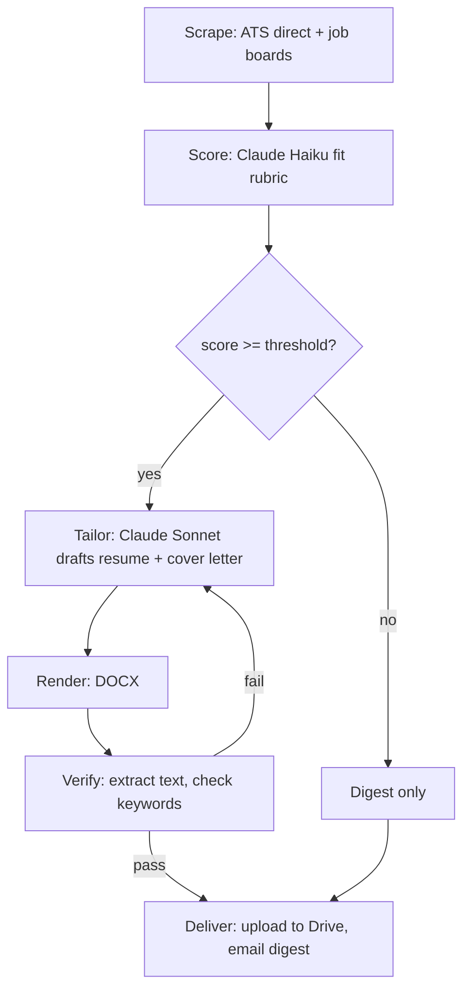

# Houndstooth


*This system is part of the working record behind my [AIDLC series](https://www.linkedin.com/in/dexterdomingo/) on AI-driven development.*

A personal job-application pipeline. It scrapes job postings, scores them for fit
using an LLM, drafts a tailored resume and cover letter for the strong matches,
verifies the generated documents before trusting them, and delivers everything
as an emailed digest with links to the uploaded files.

It has been running daily in production, unattended, since July 2026.

The name: a hound hunts, houndstooth is a suit fabric. It hunts jobs and tailors suits.

## Why this repo has no data

This is the code, not the run. The live pipeline's state, meaning every scraped
job, every score, every generated resume, and the candidate's own resume facts,
is personal and stays in a private repo. What's here is the engineering: the
scraping, the scoring pipeline, the anti-fabrication guardrail, the document
rendering and verification, and the delivery plumbing. `config.example.yaml`
and the `profile/*.example.*` files show the shape of the real inputs with
fictional data, and `sample_output/digest_example.md` shows the shape of a
real output the same way. Nothing in this repo is a real job, a real score,
or a real resume.

<p align="right">(<a href="#houndstooth">back to top</a>)</p>

## Architecture

Four stages, each one a plain Python module, each one runnable on its own.



**Scrape** (`jobhunt/scrape_ats.py`, `jobhunt/scrape_boards.py`). Two sources
run in parallel. Direct ATS endpoints (Greenhouse, Lever, Ashby, Workday) are
queried straight, since a company's own careers API is the freshest, cleanest
copy of its openings and has no anti-bot friction. Job boards (Indeed, Google
Jobs, ZipRecruiter, optionally LinkedIn) are pulled through
[JobSpy](https://github.com/speedyapply/JobSpy) for broader reach. Everything
lands in a SQLite table with a cross-source dedupe hash, and when the same job
shows up from both an ATS and a board, the ATS copy wins (`jobhunt/db.py`).

**Score** (`jobhunt/score.py`). Three cheap stages run before any LLM call:
hard title/salary filters, then a keyword prefilter against the candidate's
own profile. Only what survives both goes to the LLM, which returns a
structured score, a one-line verdict, matched requirements, gaps, dealbreakers,
and resume-targeting tips, all as a single JSON object.

**Tailor** (`phase2_tailor.py`, `jobhunt/tailor/`). For jobs scoring at or
above a threshold, a second LLM call drafts a tailored resume and cover
letter. This is the stage with the guardrail, covered below.

**Render + verify** (`jobhunt/tailor/renderers/`, `jobhunt/tailor/verify.py`).
The drafted content becomes an actual `.docx` (or `.pdf`, pluggable). The
renderer never writes free text the model invented, it only lays out fields
from a JSON schema. After rendering, `verify.py` extracts the text back out of
the document and checks it isn't empty, isn't garbled, and actually contains
the keywords the drafter said it would mirror. A failed verification triggers
a revision cycle (max 2 retries) before the job is flagged for manual review
instead of silently shipped.

**Deliver** (`jobhunt/deliver.py`). Verified documents upload to Google Drive,
and an HTML digest with the ranked jobs and live document links gets emailed.

`run_all.py` chains scrape and score. `phase2_tailor.py` and
`python -m jobhunt.deliver` run the last two stages. All four are also wired
as separate steps in `.github/workflows/daily.yml` so a bad step doesn't have
to invalidate the ones before it.

<p align="right">(<a href="#houndstooth">back to top</a>)</p>

## The anti-fabrication guardrail

The risk in an LLM writing your resume isn't tone, it's invented experience.
The fix here isn't a prompt instruction asking the model to behave; it's a
structural constraint enforced in code.

`profile/resume_template.json` (see the `.example.json` version in this repo)
holds the candidate's real experience as a bank of pre-written, human-authored
bullets, each with a stable `id`. The tailoring prompt in
`jobhunt/tailor/drafter.py` gives the model that entire bank and one degree of
freedom: pick which existing `id`s to select and in what order, per job. It
cannot write new bullet text. After the model responds,
`_validate_no_fabrication()` diffs the returned `id`s against the known set
and raises if the model invented one:

```python
def _validate_no_fabrication(draft: dict, facts: dict) -> None:
    valid_ids = {b["id"] for exp in facts.get("experience", []) for b in exp.get("bullets", [])}
    valid_ids |= {b["id"] for proj in facts.get("projects", []) for b in proj.get("bullets", [])}
    selected = draft.get("resume", {}).get("selected_bullets", [])
    unknown = [bid for bid in selected if bid not in valid_ids]
    if unknown:
        raise ValueError(f"drafter fabricated bullet ids not in resume_template.json: {unknown}")
```

That's the whole mechanism: allowlist, not instruction. The model summarizes
and reorders, freely, in its own words. It cannot add a skill, a metric, or a
line of experience that doesn't already exist in that file, because there's
no code path that would render text it wrote outside the bank.

<p align="right">(<a href="#houndstooth">back to top</a>)</p>

## Cost design

Two different jobs get two different models. Fit-scoring runs against every
prefiltered job, so it uses Claude Haiku, cheap enough to run in bulk.
Tailoring only runs for jobs that already cleared the score threshold, a much
smaller set, and produces the actual deliverable, so it uses Claude Sonnet.
Cheap model for volume, strong model for the output that matters.

On top of the model split, `scoring.max_jobs_per_run` in the config is a hard
cap: even if the backlog is larger, only that many jobs get an LLM call in a
single run. It's a blunt instrument, not a budget forecast, and that's the
point, it bounds the worst case regardless of how much the scrape stage found.

<p align="right">(<a href="#houndstooth">back to top</a>)</p>

## Reliability lessons

A few things broke in the first two weeks of running this in CI, and the
fixes are still visible in the code and the workflow file.

**External cron beats GitHub's `schedule:` trigger.** GitHub Actions' own cron
is best-effort with no delivery guarantee, and in practice that meant a
149-minute delay on one run and two dropped runs outright, both around
round-minute slots like `:00`. The fix was to stop depending on it: an
external scheduler ([cron-job.org](https://cron-job.org)) fires an HTTP POST
against the `workflow_dispatch` REST API at a fixed time, and GitHub's queue
handles it the same second. The `schedule:` block in `daily.yml` is left in
only as an odd-minute best-effort backstop, not the primary trigger, and the
workflow's `concurrency` group keeps a double-fire from racing on the
committed state.

**Store paths relative to the repo root, not absolute.** Local development
and the CI runner don't share a filesystem layout. Any path written to the
database from a local run (a tailored-document path, for instance) has to be
relative, or it silently breaks the moment CI reads it back.

**OAuth, not a service account, for personal Google Drive.** Service accounts
have zero storage quota on a personal (non-Workspace) Google account, only
Shared Drives, a Workspace-only feature, get around that. So delivery
authenticates as the account owner via an OAuth refresh token
(`gdrive_authorize.py` mints it once, interactively, and CI reuses the token
from then on) instead of a service-account key. Uploads land in a folder the
account already owns, no sharing step required.

<p align="right">(<a href="#houndstooth">back to top</a>)</p>

## Testing and verification

There's no mocked test suite here, this is a small personal automation, not a
library. What "tested" means in practice:

- `jobhunt/tailor/verify.py` is the automated check that runs on every real
  execution: it extracts text back out of every rendered document and fails
  the job (triggering a retry) if the text is too short, contains mojibake,
  or is missing a keyword the drafter said it would mirror.
- `_validate_no_fabrication()` in `drafter.py` runs on every drafting call and
  raises immediately if the model selects a bullet `id` that doesn't exist.
- Running any stage end to end against real data requires an
  `ANTHROPIC_API_KEY` (scoring and tailoring) and, for delivery,
  `GMAIL_APP_PASSWORD` plus the three `GDRIVE_*` OAuth values from
  `gdrive_authorize.py`. Without those, `python run_all.py --skip-boards
  --skip-ats` and the renderer/verifier can still be exercised directly
  against hand-written JSON matching the schema in `jobhunt/tailor/drafter.py`,
  which is how the renderers were originally built and checked before the
  drafting call was wired in.
- There's no CI test job in `daily.yml`, the daily run against real (private)
  data is the test. That's a fair tradeoff for a single-user tool with a
  human reading the digest every morning; it would not be a fair tradeoff for
  anything with more than one user depending on it.

<p align="right">(<a href="#houndstooth">back to top</a>)</p>

## Setup, if you want to run your own fork

```bash
python3 -m venv .venv && source .venv/bin/activate
pip install -r requirements.txt
export ANTHROPIC_API_KEY=your-anthropic-api-key
cp config.example.yaml config.yaml   # then edit: your search terms, ATS targets, email
cp profile/resume_template.example.json profile/resume_template.json   # then fill in your real facts
cp profile/resume_profile.example.md profile/resume_profile.md         # then fill in your real facts
```

```bash
python run_all.py            # scrape + score + report
python phase2_tailor.py      # tailor docs for jobs scoring >= config threshold
python -m jobhunt.deliver    # upload to Drive + email the digest
```

Delivery needs a one-time Google OAuth setup: create a Google Cloud project,
enable the Drive API, create a Desktop-app OAuth client, then run
`python gdrive_authorize.py /path/to/client_secret.json` locally. It opens a
browser for a one-time consent screen and prints the three values
(`GDRIVE_CLIENT_ID`, `GDRIVE_CLIENT_SECRET`, `GDRIVE_REFRESH_TOKEN`) to set as
env vars or GitHub Actions secrets.

<p align="right">(<a href="#houndstooth">back to top</a>)</p>

## For hiring managers

This is a real, running system I built and operate for my own job search, not
a portfolio exercise. It reflects how I think about LLM reliability: put the
safety constraint in code where it can't be prompted away, verify output
before trusting it, and design for the failure modes of the infrastructure
around the model, not just the model itself.
